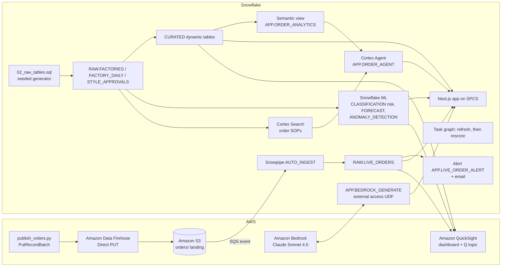

# Vietnam Garment Buyer Order Risk

Buyer-order analytics for **40 fictional garment factories across 8 Vietnamese cities and provinces** (Ho Chi Minh City, Binh Duong, Dong Nai, Long An, Hanoi, Nam Dinh, Thai Binh and Da Nang) and 5 product categories: knit tops, woven shirts, denim, outerwear and sportswear. Each buyer purchase order either leaves the factory by its ex-factory date or it does not. Built on Snowflake, optionally with AWS, the demo turns order shipments into on-time shipment KPIs, a 7-day late-shipment risk score per factory, an order risk alert email and an AI action memo for the head of merchandising. Order risk flags are demo signals on synthetic data, not buyer compliance or audit verdicts.

## Architecture

A buyer-order pipeline built on **Snowflake** (Dynamic Tables, Snowflake ML, Cortex Search, Cortex Agent, Cortex AI_COMPLETE, SPCS) and, in the full build, **AWS** (Amazon Data Firehose, Amazon S3, Bedrock Claude, QuickSight + Amazon Q). Order-status updates from factories are an event stream, so the AWS build sends them through a Firehose stream to S3, and Snowpipe loads them into `RAW.LIVE_ORDERS`. Dynamic tables curate 90 days of factory-day history: buyer-order shipments and pieces shipped, pieces shipped by the ex-factory date, order risk flags, confirmed late shipments, lots held at final inspection, weekly work-in-progress (WIP) status reviews and pre-production (PP) sample approval coverage. Snowflake ML scores 7-day late-shipment risk per factory, forecasts network-wide order shipments and flags WIP gap anomalies. A Cortex Agent answers questions with SOP citations, and an LLM drafts the action memo.

Interactive diagrams (hover for object names): [Snowflake only](docs/architecture-snowflake.html) | [AWS + Snowflake](docs/architecture-aws.html). The app shows both on its Architecture & Data tab, the current build first. Regenerate them with `python3 docs/build_architecture.py aws snowflake`.



The Snowflake-only build drops the AWS subgraph: `APP.SIMULATE_ORDERS` writes to `RAW.LIVE_ORDERS`, and the app calls Cortex `AI_COMPLETE` instead of the Bedrock UDF.

## Snowflake Capabilities

| Capability | Implementation |
|-----------|---------------|
| Dynamic Tables | `CURATED.KPI_SUMMARY`, `PERFORMANCE_SUMMARY`, `SIGNAL_SUMMARY`, `TREND_ANALYSIS` from the RAW tables |
| Snowflake ML | CLASSIFICATION 7-day late-shipment risk (`ML.LATE_RISK_SCORES`), 14-day order shipment FORECAST, WIP gap ANOMALY_DETECTION |
| Cortex Search | 11 synthetic order-risk follow-up SOPs (one per product category and order-risk signal) in `SEARCH.ORDER_SOP_SEARCH` |
| Semantic View | `APP.ORDER_ANALYTICS` over factories, order-risk signals, daily totals and risk |
| Cortex Agent | `APP.ORDER_AGENT`: Cortex Analyst over the semantic view plus Cortex Search for SOP citations |
| Cortex AI | `AI_COMPLETE('claude-sonnet-4-5')` for grounded answers, and for the action memo in the Snowflake-only build |
| Alerts + Tasks | `APP.LIVE_ORDER_ALERT` logs FLAG events and sends email; task graph `TASK_REFRESH_CURATED`, then `TASK_RESCORE_RISK` |
| Snowpark Container Services | Next.js app `APP.VN_TEXTILE_ORDER_APP` with 6 tabs: Executive Cockpit, Predictive, WIP Reviews, Live Order Status, Ask AI, Architecture & Data |
| Snowpipe | `RAW.LIVE_ORDERS_PIPE` AUTO_INGEST from S3 (AWS build only) |

## AWS Services

Used only in the AWS + Snowflake build.

| Service | Role in Demo |
|---------|-------------|
| Amazon Data Firehose | Direct PUT Firehose stream `vn-textile-order-order-status`: `aws/publish_orders.py` sends buyer order-status events with PutRecordBatch; Firehose buffers up to 60 s or 1 MB and writes newline-delimited JSON to S3 |
| Amazon S3 | Landing bucket (`orders/`). An event notification goes to the Snowpipe SQS queue; Firehose errors go to `firehose-errors/` |
| Amazon Bedrock | Claude Sonnet 4.5 writes the action memo, called from Snowflake through an external-access UDF |
| Amazon QuickSight | DIRECT_QUERY executive dashboard over Snowflake (daily buyer-order shipments and order risk flags, confirmed late shipments by factory, late-shipment risk) |
| Amazon Q | Natural-language questions over the QuickSight topic `vn-textile-order-topic` |
| AWS IAM | Least-privilege roles for Snowflake S3 reads and Firehose S3 writes, and a Bedrock-only invoke user |

## Personas

These personas are fictional.

| Persona | Role | Key Questions |
|---------|------|---------------|
| **Do Thi Lan** | Head of Merchandising | "How many garment pieces left our factories by the buyer ex-factory date, by product category?" "Which order-risk signals turn into confirmed late shipments?" |
| **Vo Minh Khang** | Production Planning Lead | "Which factories are high risk this week, and which SOP applies?" |

## Data

All data is synthetic and seeded, so every rebuild reproduces it. The factories, buyers, orders and names are fictional; the cities and provinces are real places used only as labels, and nothing here describes a real company or site.

| Table | Rows | Description |
|-------|------|-------------|
| RAW.FACTORIES | 40 | Garment factories: every combination of 8 cities or provinces and 5 product categories (knit tops, woven shirts, denim, outerwear, sportswear), with risk tier, years supplying the buyer programme and size |
| RAW.FACTORY_DAILY | 3,600 | Daily factory observations over 90 days: buyer-order shipments, thousand pieces shipped and shipped by the ex-factory date, order risk flags, confirmed late shipments, lots held at final inspection, order-risk signal, WIP status reviews due and completed, WIP gap against plan and late share. Includes two area-wide grid power curtailment days (Nam Dinh and Binh Duong) |
| RAW.STYLE_APPROVALS | 40 | Active styles on order, styles with an approved PP sample on file and PP sample approvals pending per factory |
| SEARCH.ORDER_SOP_DOCS | 11 | Synthetic order-risk follow-up SOPs indexed for Cortex Search (not buyer compliance or audit guidance) |
| RAW.LIVE_ORDERS | Grows during the demo | Live buyer order-status events from the Firehose stream and S3 (AWS build) or `APP.SIMULATE_ORDERS` (Snowflake-only build) |
| ML.LATE_RISK_SCORES | 40 | 7-day late-shipment probability and risk band per factory |

## Build Instructions

### Prerequisites
- Snowflake account with ACCOUNTADMIN access, and Cortex AI enabled (AI_COMPLETE, Search, Agent).
- An X-Small warehouse with auto-suspend at or below 120 s, and an existing SPCS compute pool.
- Python 3.11+, `snowflake-connector-python`, Node.js 22+, Docker and the `snow` CLI.
- App image: run `snow spcs image-registry login`, then build and push `vn-textile-order-app:v1` to the database's `APP.IMAGES` repository (see the header of `snowflake/07_deploy_app.sql`).
- AWS build only: `boto3`, AWS credentials for the target account (us-west-2) with Firehose and Bedrock access, and QuickSight Enterprise.

### SPCS App
```
<DATABASE>.APP.VN_TEXTILE_ORDER_APP
```

### Tests
```bash
python -m pytest aws snowflake quicksight
```

For a local run, put `SNOWFLAKE_ACCOUNT`, `SNOWFLAKE_USER`, `SNOWFLAKE_DATABASE`, `SNOWFLAKE_WAREHOUSE`, `SNOWFLAKE_AUTHENTICATOR=PROGRAMMATIC_ACCESS_TOKEN`, `SNOWFLAKE_TOKEN` and `DEMO_PLATFORM` in the environment, then run `npm --prefix app run build && npm --prefix app start`.

## Build Modes

Both modes share the same core. They differ in three places, and the app's `DEMO_PLATFORM` setting (in its SPCS spec) switches the memo provider and the Live Order Status tab.

| Layer | Snowflake Only | Full AWS + Snowflake |
|---|---|---|
| Live order status | `CALL APP.SIMULATE_ORDERS(n)` inserts simulated buyer order-status events into `RAW.LIVE_ORDERS`. This simulates a factory order-status feed; it is not Snowpipe Streaming | `aws/publish_orders.py` sends buyer order-status events to an Amazon Data Firehose stream, which writes them to S3, then SQS and Snowpipe AUTO_INGEST |
| Action memo | Cortex `AI_COMPLETE('claude-sonnet-4-5')` | Amazon Bedrock Claude Sonnet 4.5 through `APP.BEDROCK_GENERATE` |
| BI and natural-language questions | The SPCS app is the dashboard; questions go to the Cortex Agent | Also a QuickSight dashboard and an Amazon Q topic |
| App setting | `DEMO_PLATFORM: snowflake` | `DEMO_PLATFORM: aws` |

### Snowflake Only

```bash
# 1. Core data and dynamic tables (guarded: new isolated database only)
python snowflake/run_core.py --database VIETNAM_TEXTILE_ORDER_SNOWFLAKE --warehouse <XS_WAREHOUSE> --connection <CONNECTION> --apply
# 2. Native order-status feed, ML, search, semantic view, agent, alert and task graph
python snowflake/run_intelligence.py --database VIETNAM_TEXTILE_ORDER_SNOWFLAKE --platform snowflake --warehouse <XS_WAREHOUSE> --connection <CONNECTION> --alert-email <ALERT_EMAIL>
# 3. App on SPCS with DEMO_PLATFORM=snowflake (push the image first)
python snowflake/run_intelligence.py --database VIETNAM_TEXTILE_ORDER_SNOWFLAKE --platform snowflake --warehouse <XS_WAREHOUSE> --connection <CONNECTION> --alert-email <ALERT_EMAIL> --files 07_deploy_app.sql --compute-pool <COMPUTE_POOL>
```

During the demo:
- Run `CALL APP.SIMULATE_ORDERS(20)` to add live order-status events. For a continuous feed, run `ALTER TASK APP.TASK_SIMULATE_ORDERS RESUME`, and `SUSPEND` it afterwards.
- Run `EXECUTE ALERT APP.LIVE_ORDER_ALERT` to raise the order risk alert email.
- Run `EXECUTE TASK APP.TASK_REFRESH_CURATED` to refresh the curated tables and rescore late-shipment risk.

Afterwards, drop the database or run `ALTER SERVICE APP.VN_TEXTILE_ORDER_APP SUSPEND`.

### Full AWS + Snowflake

```bash
# 1. Core data and dynamic tables (guarded: new isolated database only)
python snowflake/run_core.py --database VIETNAM_TEXTILE_ORDER_AWS --warehouse <XS_WAREHOUSE> --connection <CONNECTION> --apply
# 2. AWS ingestion and Bedrock (dry run first, then --apply)
python aws/setup_aws.py --database VIETNAM_TEXTILE_ORDER_AWS --account <AWS_ACCOUNT_ID> --connection <CONNECTION> --apply
# 3. ML, search, semantic view, agent, alert and task graph
python snowflake/run_intelligence.py --database VIETNAM_TEXTILE_ORDER_AWS --platform aws --warehouse <XS_WAREHOUSE> --connection <CONNECTION> --alert-email <ALERT_EMAIL>
# 4. App on SPCS with DEMO_PLATFORM=aws (push the image first)
python snowflake/run_intelligence.py --database VIETNAM_TEXTILE_ORDER_AWS --platform aws --warehouse <XS_WAREHOUSE> --connection <CONNECTION> --alert-email <ALERT_EMAIL> --files 07_deploy_app.sql --compute-pool <COMPUTE_POOL>
# 5. QuickSight dashboard and Q topic (needs an existing Snowflake data source)
python quicksight/build_dashboards.py --database VIETNAM_TEXTILE_ORDER_AWS --account <AWS_ACCOUNT_ID> --principal-arn <QUICKSIGHT_USER_ARN> --data-source-arn <DATA_SOURCE_ARN> --prefix vn-textile-order --apply --update --with-topic
```

QuickSight objects must be shared with the QuickSight user who signs in (`--principal-arn`); otherwise the console shows nothing.

During the demo:
- Run `python aws/publish_orders.py --count 20` to send a batch of live order-status events to the Firehose stream. Firehose delivers them to S3 within about 60 seconds, and Snowpipe loads them shortly after.
- Run `EXECUTE ALERT APP.LIVE_ORDER_ALERT` to raise the order risk alert email.
- Run `EXECUTE TASK APP.TASK_REFRESH_CURATED` to refresh the curated tables and rescore late-shipment risk.

Afterwards, `python aws/teardown_aws.py --database VIETNAM_TEXTILE_ORDER_AWS --account <AWS_ACCOUNT_ID> --connection <CONNECTION> --apply` removes the AWS resources (Firehose stream, bucket, roles, Bedrock user) and the account-level Bedrock external-access and S3 storage integrations. It leaves the email integration `VN_TEXTILE_ORDER_EMAIL_INT`, which the Snowflake-only build also uses.

## Business Impact

Snowflake customer outcome from an apparel brand (the Vietnam garment context is described generically; no market figures are claimed):
- **Under Armour** (Snowflake customer): product margin reporting "required a week of manual work" and "only ran once a month"; on Snowflake, "this automated process runs daily", and "Inventory, supply chain, demand planning, point-of-sale and sales teams now operate from the same numbers" -- [Snowflake customer story: Under Armour](https://www.snowflake.com/en/customers/all-customers/case-study/under-armour/)

## Key Demo Numbers

These figures are synthetic and come from the seeded demo data. Forecast and anomaly figures can shift slightly with the build day.

- **40 garment factories** (8 cities or provinces x 5 product categories), 3,600 factory-days over 90 days: **16,919 buyer-order shipments** and 158.9 million pieces shipped, with **88.2% of pieces on time**. Knit tops factories are most punctual (90.3%) and outerwear factories least (80.9%)
- **527 order risk flags** and **158 confirmed late shipments**, so flag precision is 30.0%; **46 lots** held at final inspection. The factory with the most confirmed late shipments is FAC-0027 Long An Outerwear factory (16)
- **Line efficiency below plan** produces the most confirmed late shipments (32 of 98 flags); the 10 grid power curtailment flags are never confirmed
- **Late-shipment risk model** out-of-time holdout (600 factory-days): precision 0.57, recall 0.31 at a 0.5 threshold, against a 0.23 base rate. Seven factories are high risk; the top one is FAC-0023 Da Nang Denim factory, at 94.1%
- **14-day order shipment forecast** of about 189 shipments per day, with prediction intervals; **57 of 640** factory-days flagged as WIP gap anomalies
- **WIP review completion 72.1%**, PP sample approval coverage 74.7% of 1,802 active styles, with 128 PP sample approvals pending
- **11 SOPs** indexed for Cortex Search and cited by ID in agent answers

## License

Apache 2.0 — See [LICENSE](LICENSE) for details.

This is a personal demo project and is not an official Snowflake offering. It comes with no support or warranty. It is not buyer compliance, audit or investment advice. Customer outcomes are taken from the cited Snowflake customer story; they are not guarantees of results.
